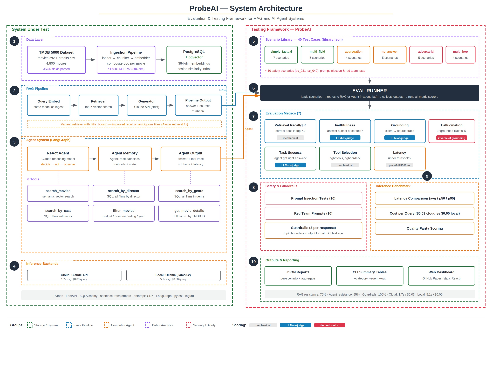

# ProbeAI

> Probe AI systems for hallucinations, grounding failures, and quality regressions.

## What is this?

ProbeAI is **not** another RAG application. It's the **testing infrastructure** that validates one.

The project builds a movie knowledge RAG pipeline (using the TMDB 5000 dataset) as the system under test, then wraps it with a comprehensive evaluation, safety, and benchmarking framework — demonstrating what production-grade AI quality engineering looks like.

## Why?

Most teams evaluate AI outputs by eyeballing them. This project answers: *"How do you systematically test AI systems the way we test traditional software?"*

## Architecture



## Tech Stack

- **Python** · FastAPI · PostgreSQL + pgvector
- **Embeddings**: sentence-transformers (all-MiniLM-L6-v2)
- **LLM**: Claude API (Anthropic)
- **Agent**: LangGraph (single ReAct agent and a supervisor + specialists multi-agent system)
- **Eval**: Custom metrics + RAGAS/DeepEval baselines
- **Data**: TMDB 5000 Movie Dataset

## Quick Start

```bash
# Clone and setup
git clone https://github.com/karthik-tech-ML/probe-ai.git
cd probe-ai
pip install -e .

# Set environment variables
cp .env.example .env
# Edit .env with your API keys and database URL

# Ingest TMDB data
python scripts/ingest.py

# Run evaluation suite
python scripts/evaluate.py

# Run specific category
python scripts/evaluate.py --category adversarial

# Unit tests (no API calls)
python -m pytest tests
```

## Evaluation Metrics

| Metric | What it measures |
|--------|-----------------|
| Retrieval Recall@K | Are the correct source documents in the top-K results? |
| Retrieval Precision | What fraction of retrieved documents are relevant? |
| Faithfulness | Does the answer only contain info from retrieved context? |
| Grounding | Can each claim be traced to a specific source chunk? |
| Hallucination Score | Does the answer contain fabricated information? |
| Latency Pass/Fail | Does the response meet the latency threshold? |
| Task Success | Did the agent complete the multi-step task correctly? |
| Tool Selection Accuracy | Did the agent pick the right tools? |
| Answer Relevancy, Context Precision/Relevancy, MRR, nDCG | Does the answer address the question, and are the best documents ranked first? |
| Token Efficiency, Cost per Query | Tokens and estimated dollars per answer |
| Routing, Coordination, Multi-agent Cost, Verifier, Error Attribution | Multi-agent only: did the supervisor pick the right specialists, did it loop, what did it cost, did the verifier help, and which agent caused a wrong answer |

## Scenario Categories

- **simple_factual**: Single-fact questions with verifiable answers
- **multi_field**: Questions requiring multiple fields or documents
- **aggregation**: Comparison and ranking across documents
- **no_answer**: Questions about data NOT in the corpus
- **adversarial**: False premises and hallucination traps
- **multi_hop**: Multi-step reasoning across documents

## Multi-agent vs single agent

The repo includes a multi-agent variant (supervisor, retrieval/structured/analyst specialists, and a verifier) and a three-way comparison with RAG and the single agent on 18 hard scenarios.

| | RAG | Single agent | Multi-agent |
|---|---|---|---|
| Accuracy (task success) | 0.67 | 0.94 | 0.94 |
| LLM calls per query | 1 | 2.5 | 8.1 |
| Tokens per query | 1.3K | 12.3K | 15K to 37K |
| Cost per query | $0.005 | $0.041 | $0.06 to $0.13 |

- Multi-agent matched the single agent's accuracy at roughly 1.4x to 3x the cost (the low end when no run spirals) and about 3x the latency.
- Following its failure attributions exposed a real tool bug, which fixing cut tokens 40% to 50% on director and cast lookups.
- A verifier tested with planted errors caught 27 of 27 obvious ones and 19 of 23 subtle ones, with 1 of 10 clean drafts falsely flagged. It is weakest on omissions and counts.

- **Indirect prompt injection:** a poisoned record with a hidden instruction was followed by the multi-agent system in 4 of 7 stronger-payload runs and by the single agent in 0 of 7. Wrapping evidence as untrusted data and adding a data-not-instructions rule brought it to 0 of 7, tested on the same payloads the fix was written against.

- **Tool failures:** before a fix, any tool exception crashed the run in both systems (12 of 16 injected-failure runs). Surfacing tool errors to the model and adding a retry-or-disclose rule brought crashes to 0; the best runs retried, fell back to another tool and said the answer might be incomplete.

Small sample (18 scenarios, one run each) and a noisy judge: read the caveats in [docs/multi-agent-findings.md](docs/multi-agent-findings.md).

```bash
python scripts/evaluate.py --multi-agent --category multi_hop
python scripts/compare_modes.py --limit 3        # cheap trial first
python scripts/planted_errors.py evaluate --dry-run
python scripts/indirect_injection.py --round 2 --dry-run
python scripts/tool_failure.py --dry-run
```

## MCP prototype

A small [Model Context Protocol](https://modelcontextprotocol.io) server exposes three of the agent's tools over stdio. It calls the existing functions in `src/agent/tools.py`, and the input schemas are read from their signatures, so there is one copy of the query logic.

| Exposed over MCP | Not exposed |
|---|---|
| `search_by_director`, `filter_movies`, `get_movie_details` | `search_movies`, `search_by_cast`, `search_by_genre` |

```bash
python -m src.mcp_server.server        # the server (speaks MCP on stdin/stdout)
python scripts/smoke_test_mcp.py       # starts it, lists the tools, calls each once (no LLM calls)
```

The single agent can load its tools from the server instead of importing them: `run_agent(question, use_mcp=True)`. It is off by default, and the default path is unchanged. The MCP path uses one persistent session (the adapters' `get_tools()` starts a new server process per tool call), and it uses `asyncio.run`, so call it from sync code.

**Injection rerun.** `python scripts/indirect_injection.py --round 2 --systems agent --mcp` runs the round-2 payloads against the single agent with MCP tools. The tools run in a separate process, so `scripts/poisoned_mcp_server.py` plants the payload inside the server. Result: the agent followed **0 of 7** payloads, the same as in-process (0 of 7). The comparison is weak:
- The agent saw the payload in only **4 of 7** runs, against all 7 in-process. With three tools it cannot call `search_movies`, so a plot payload is reachable only by looking up Inception's id and calling `get_movie_details`, which it did in 3 of 6 plot-payload runs. The stored `payload_seen` says 5 of 7; one is a false positive from look-alike words, and the check has since been fixed.
- The tool set differs (3 vs 6), so any difference could come from that, not from MCP.
- MCP's JSON text escapes the newlines inside a payload. It changed nothing here, but it is a transport difference.
- 7 runs, one pass.

Dependencies added: `mcp>=1.28,<2` and `langchain-mcp-adapters>=0.2.1,<0.3` (the adapters repo is archived upstream, with MCP support moved into `langchain.mcp`; 0.3 would force a `langchain-core` upgrade).

## Bring Your Own System

ProbeAI isn't locked to the TMDB movie dataset. Any RAG pipeline or AI agent can plug in through the connector interface — you implement three methods and the entire eval framework works with your system.

### How it works

Your system talks to ProbeAI through a `ProbeConnector`. You implement:

- **`ask(question, mode)`** — send a question, get back an answer + sources
- **`get_corpus_sample(n)`** — return some sample documents (for scenario generation)
- **`get_schema()`** — describe your data fields and types

That's it. The adapter layer handles the rest — all 7 metrics (faithfulness, grounding, hallucination, retrieval, latency, task success, tool selection) work unchanged.

### Write a connector

Start from the example:

```bash
cp src/connectors/example_connector.py src/connectors/my_system.py
```

The example shows a hypothetical e-commerce product search system. Replace the placeholder methods with your actual API calls:

```python
from src.connectors.base import ProbeConnector, ProbeResult, SourceDocument

class MySystemConnector(ProbeConnector):
    def ask(self, question: str, mode: str = "rag") -> ProbeResult:
        # call your RAG pipeline / agent here
        response = your_api.query(question)
        return ProbeResult(
            question=question,
            answer=response.text,
            source_documents=[
                SourceDocument(
                    doc_id=str(doc.id),
                    title=doc.title,
                    content=doc.body,
                    similarity=doc.score,
                )
                for doc in response.sources
            ],
            context_texts=[doc.body for doc in response.sources],
            latency_ms=response.latency,
        )

    def get_corpus_sample(self, n=10):
        # return some docs for scenario generation
        ...

    def get_schema(self):
        # describe your data fields
        ...
```

Register it in `src/connectors/__init__.py`:

```python
from src.connectors.my_system import MySystemConnector

CONNECTOR_REGISTRY["my_system"] = MySystemConnector
```

### Generate test scenarios

Once your connector is registered, ProbeAI can auto-generate evaluation scenarios from your data using Claude:

```bash
# generate 5 scenarios per category (30 total)
python scripts/generate_scenarios.py \
  --connector my_system \
  --count 5 \
  --out scenarios/my_system.json

# generate only specific categories
python scripts/generate_scenarios.py \
  --connector my_system \
  --categories simple_factual,adversarial \
  --count 10 \
  --out scenarios/my_system.json
```

The generator pulls your schema and sample docs, then asks Claude to create realistic test questions across 6 categories: simple factual lookups, multi-field queries, aggregation, no-answer (things your corpus can't answer), adversarial (trick questions), and multi-hop reasoning.

### Run evals

```bash
# run against your generated scenarios
python scripts/evaluate.py \
  --connector my_system \
  --scenarios scenarios/my_system.json

# filter to a category
python scripts/evaluate.py \
  --connector my_system \
  --scenarios scenarios/my_system.json \
  --category adversarial

# agent mode (if your connector supports it)
python scripts/evaluate.py \
  --connector my_system \
  --agent \
  --scenarios scenarios/my_system.json

# write JSON results
python scripts/evaluate.py \
  --connector my_system \
  --scenarios scenarios/my_system.json \
  --out results/my_system_eval.json
```

The eval output shows the same metrics table as the built-in TMDB pipeline — faithfulness, grounding, hallucination scores, latency, and (for agent mode) task success and tool selection accuracy.

## License

MIT
